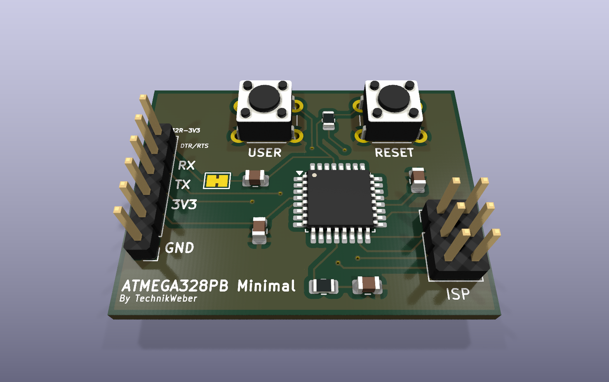

# ATmega328PB minimal board

  
  
  

A minimal breakout board for the ATmega328PB (TQFP-32): just what the chip needs to run,
be programmed and talk to a PC — a starting point for small AVR projects.

## What is on it

| Part | Purpose |
|---|---|
| ATmega328PB-A (TQFP-32) | The microcontroller, on its internal oscillator |
| 2×3 ISP header | Programming with any AVR ISP programmer (USBasp, AVRISP mkII, …) |
| 1×6 header for an FTDI TTL-232R-3V3 cable | Serial connection and 3.3 V power from a USB-UART cable; DTR/RTS allows auto-reset for a bootloader |
| RESET and USER buttons | Reset, and one button for your own firmware |
| LED with 220 Ω | Status LED |
| 3 × 100 nF, 10 kΩ reset pull-up | Decoupling and reset |

## Files

- `ATMEGA328PB_Minimal.kicad_sch` / `.kicad_pcb` — schematic and PCB (KiCad)

## License

[MIT](LICENSE).
